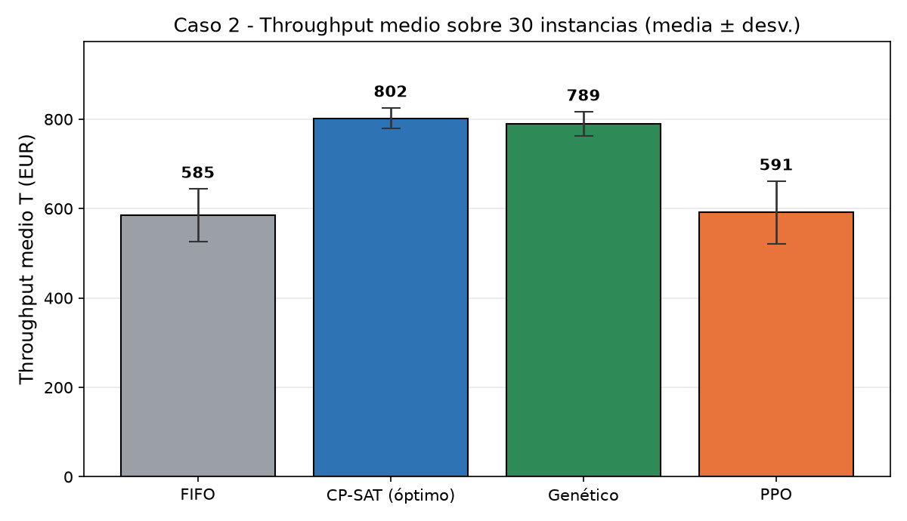
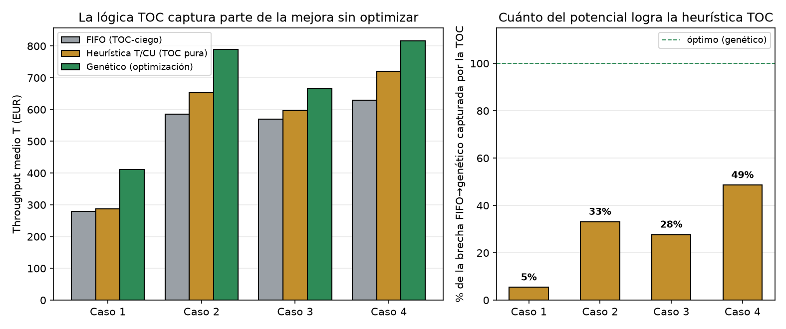
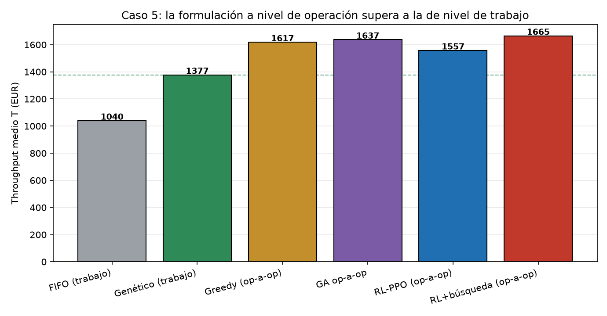

# Inteligencia Artificial y Teoría de las Restricciones en la programación de la producción

[Read in English](README.md)

Código del Trabajo Fin de Grado **«Aplicación de técnicas de Inteligencia Artificial a la optimización de la producción industrial mediante la Teoría de las Restricciones»** (Universidad de Sevilla, 2026 — sobresaliente, 9/10).

**Autor:** Carlos Daniel Ruiz Riego · **Tutor:** Pablo Cortés Achedad
Grado en Ingeniería de las Tecnologías Industriales (Organización Industrial), Escuela Técnica Superior de Ingeniería, Universidad de Sevilla.

## Resumen

El trabajo compara varios métodos de programación de la producción (*scheduling*) en plantas modeladas según la **Teoría de las Restricciones (TOC)**. Todos los métodos se evalúan con el **mismo simulador de eventos discretos** y la **misma función objetivo**: el *throughput* obtenido dentro de un horizonte finito.

**Resultado principal:** las secuencias optimizadas aumentaron el *throughput* entre un **17 % y un 47 % frente a una regla FIFO convencional** en los escenarios simulados, sin modificar los recursos de la planta. Las diferencias se validaron estadísticamente sobre 30 instancias por caso con el test de Wilcoxon.

## Métodos comparados

| Método | Implementación |
|---|---|
| Programación por restricciones | Google OR-Tools CP-SAT |
| Algoritmo genético | Codificación por permutación de órdenes (DEAP) |
| Aprendizaje por refuerzo | PPO con política de red densa (Stable-Baselines3 + Gymnasium) |
| Aprendizaje por refuerzo + GNN | PPO con red neuronal de grafos sobre el grafo disyuntivo (PyTorch) y su reformulación a nivel de operación |
| Referencia | Regla de despacho FIFO |

## Casos de estudio (complejidad creciente)

| Caso | Planta |
|---|---|
| 1 | Job Shop de producto homogéneo |
| 2 | Job Shop multiproducto con mínimos contractuales |
| 3 | Flow Shop con decisión de mix de producto |
| 4 | Flow Shop con tiempos de cambio dependientes de la secuencia en el cuello |
| 5 | Job Shop grande, multifamilia, con doble cuello de botella y tiempos de cambio |

## Resultados

*Throughput* medio (EUR) sobre 30 instancias por caso, con todos los métodos en el mismo simulador. La cifra del 17–47 % es la mejora del algoritmo genético frente al FIFO (última columna).

| Caso | FIFO | Genético | PPO (red densa) | CP-SAT* | Genético frente a FIFO |
|---|---|---|---|---|---|
| 1 | 280 | 411 | 273 | 595 | +47 % |
| 2 | 585 | 789 | 591 | 802 | +35 % |
| 3 | 570 | 666 | 631 | 682 | +17 % |
| 4 | 629 | 816 | 615 | 844 | +30 % |

\* La cifra de CP-SAT es el valor de su propio modelo, que exige ejecutar el programa completo con sus instantes de inicio; los demás métodos deciden únicamente el orden de lanzamiento. Su optimalidad está demostrada en todas las instancias de los casos 1 a 3; en el caso 4 se agota el límite de tiempo en la mayoría.



*Caso 2 — media ± desviación típica sobre 30 instancias.*

- **Algoritmo genético:** el mejor método de los que deciden el orden de lanzamiento en los cuatro casos (Wilcoxon, p < 0,001 frente al FIFO), a entre un 1,6 % y un 3,3 % del valor de CP-SAT en los casos 2 a 4.
- **PPO con red densa:** se queda al nivel del FIFO en los casos 1, 2 y 4 (sin diferencia significativa) y solo lo mejora en el caso 3.
- **PPO con red de grafos y búsqueda en inferencia:** alcanza el nivel del genético en los casos medios: 798 frente a 789 en el caso 2 (no significativo) y 829 frente a 816 en el caso 4 (p = 0,04).
- **Ablación de la TOC:** una heurística basada solo en T/CU, sin optimizar, captura entre el 28 % y el 49 % de la brecha entre FIFO y genético en los casos 2 a 4 (un 5 % en el caso 1).



El **caso 5** (20 órdenes, 6 máquinas y dos cuellos de botella) es donde más pesa la formulación. Decidir operación a operación, en vez de ordenar trabajos completos, sitúa el *throughput* muy por encima de los métodos a nivel de trabajo:

| Método | *Throughput* (EUR) |
|---|---|
| FIFO | 1 040 |
| Genético sobre permutaciones de trabajos | 1 377 |
| Regla *greedy* a nivel de operación | 1 617 |
| Genético a nivel de operación | 1 637 |
| Agente de refuerzo (GNN) con búsqueda, a nivel de operación | 1 665 |
| Programa de CP-SAT (con límite de tiempo) | 1 799 |



## Aspectos metodológicos

- **Simulador único** (SimPy) para todos los métodos, para que la comparación sea válida.
- Modelo CP-SAT alineado con el objetivo de la TOC (maximizar el *throughput* en el horizonte, no el *makespan*).
- 30 instancias aleatorias por caso, con media ± desviación y contrastes estadísticos no paramétricos.
- Validación del modelo exacto con la instancia **ft06** de la OR-Library (óptimo conocido = 55).
- Estudios adicionales: ablación de la lógica TOC, parametrización del genético, robustez del PPO frente a la semilla, profundidad de la red de grafos y búsqueda en inferencia, y transferencia del agente a instancias de otro tamaño.

## Estructura del repositorio

```
.
├── src/          # todo el código (simulador, plantas, métodos, estudios, verificaciones)
├── results/      # resultados JSON generados por los estudios
├── figures/      # figuras generadas por los estudios
├── docs/         # figuras que se muestran en este README
├── requirements.txt
└── README.md
```

### Ficheros principales de `src/`

| Fichero | Contenido |
|---|---|
| `planta_simulada.py` | Simulador común (SimPy): planta Job Shop con métricas TOC |
| `planta_caso2.py` … `planta_caso5.py` | Modelos de planta de los casos 2 a 5 |
| `analisis_oportunidad.py` | Análisis de coste de oportunidad (TOC) |
| `estudio_c1.py` … `estudio_c5.py` | Estudio principal de cada caso |
| `gnn_grafo.py` | Red neuronal de grafos sobre el grafo disyuntivo |
| `l2d_c5.py` | Formulación a nivel de operación para el Caso 5 |
| `estudio_ppo_*.py`, `estudio_gnn_search.py`, `estudio_l2d_*.py` | Estudios de aprendizaje por refuerzo |
| `estudio_params_ga*.py` | Parametrización del algoritmo genético |
| `estudio_benchmarks.py`, `estudio_ablacion_toc.py` | Benchmarks y ablación de la TOC |
| `verificacion_*.py` | Verificaciones del modelo exacto (CP-SAT): optimalidad, discretización temporal, reglas de proyección |
| `escenario*.py`, `caso2_*.py`, `caso3_*.py` | Primera versión de cada método. Los genéticos de los casos 2 y 3 son un prototipo multiobjetivo (NSGA-II) descartado; ningún resultado de la memoria procede de ellos |

## Instalación y uso

Python 3.11 o superior.

```bash
pip install -r requirements.txt
python src/estudio_c1.py
```

Los scripts se pueden ejecutar desde cualquier carpeta. Los resultados se guardan en `results/` y las figuras en `figures/`.

> Nota: los estudios de aprendizaje por refuerzo entrenan redes neuronales y pueden tardar horas en CPU. Los de CP-SAT y el algoritmo genético tardan minutos.

## Tecnologías

Python · OR-Tools CP-SAT · SimPy · DEAP · Stable-Baselines3 · Gymnasium · PyTorch · NumPy · SciPy · Matplotlib

## Licencia

MIT — ver [LICENSE](LICENSE).
