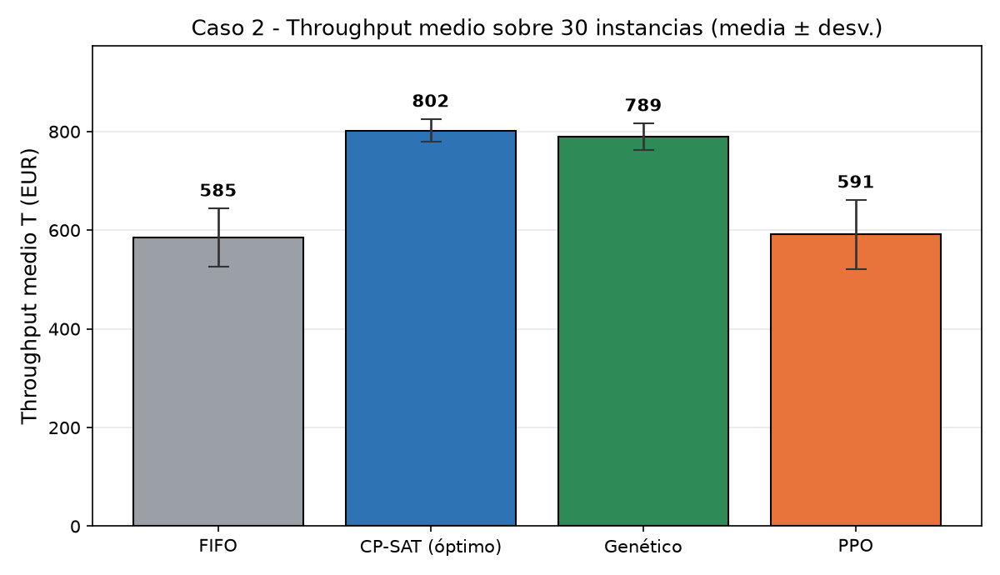
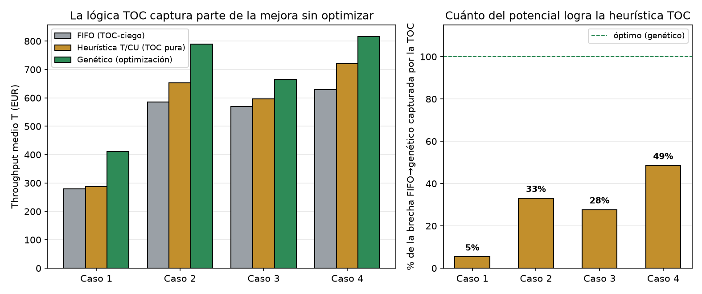
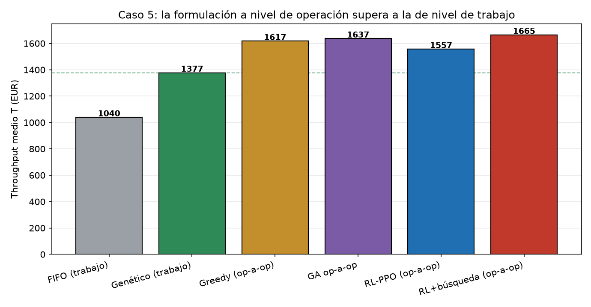

# AI and Theory of Constraints for Production Scheduling

[Leer en español](README.es.md)

Code for my bachelor's thesis **"Application of Artificial Intelligence techniques to industrial production optimisation through the Theory of Constraints"** (University of Seville, 2026 — grade 9/10).

**Author:** Carlos Daniel Ruiz Riego · **Supervisor:** Pablo Cortés Achedad
BSc in Industrial Technology Engineering (Industrial Management), Escuela Técnica Superior de Ingeniería, Universidad de Sevilla.

## Summary

The project compares production scheduling methods on plants modelled according to the **Theory of Constraints (TOC)**. Every method is evaluated on the **same discrete-event simulator** and with the **same objective**: throughput achieved within a finite horizon.

**Key result:** the optimised schedules increased throughput by **17–47% over a conventional FIFO dispatching rule** across the simulated scenarios, without changing plant resources. Differences were validated statistically over 30 instances per case with the Wilcoxon test.

## Methods compared

| Method | Implementation |
|---|---|
| Constraint programming | Google OR-Tools CP-SAT |
| Genetic algorithm | Permutation encoding of orders (DEAP) |
| Reinforcement learning | PPO with a dense policy network (Stable-Baselines3 + Gymnasium) |
| Reinforcement learning + GNN | PPO with a graph neural network over the disjunctive graph (PyTorch), plus an operation-level reformulation |
| Baseline | FIFO dispatching rule |

## Case studies (increasing complexity)

| Case | Plant |
|---|---|
| 1 | Job Shop, homogeneous product |
| 2 | Multi-product Job Shop with contractual minimums |
| 3 | Flow Shop with product-mix decision |
| 4 | Flow Shop with sequence-dependent setup times at the bottleneck |
| 5 | Large multi-family Job Shop with two bottlenecks and setup times |

## Results

Mean throughput (EUR) over 30 instances per case, all methods on the same simulator. The 17–47% headline is the genetic algorithm's gain over FIFO (last column).

| Case | FIFO | Genetic algorithm | PPO (dense) | CP-SAT* | Genetic vs FIFO |
|---|---|---|---|---|---|
| 1 | 280 | 411 | 273 | 595 | +47% |
| 2 | 585 | 789 | 591 | 802 | +35% |
| 3 | 570 | 666 | 631 | 682 | +17% |
| 4 | 629 | 816 | 615 | 844 | +30% |

\* CP-SAT is the value of its own model, which requires executing the full schedule with its start times; the other methods only decide the release order of the jobs. It is proven optimal in every instance of cases 1–3; in case 4 the time limit is reached in most instances.



*Case 2 — mean ± standard deviation over 30 instances (figure labels in Spanish).*

- **Genetic algorithm:** the best order-release method in all four cases (Wilcoxon p < 0.001 vs FIFO), within 1.6–3.3% of the CP-SAT value in cases 2–4.
- **Dense PPO:** stays at FIFO level in cases 1, 2 and 4 (no significant difference) and improves on it only in case 3.
- **Graph-based PPO with inference-time search:** reaches the genetic algorithm's level on the mid-size cases — 798 vs 789 in case 2 (not significant) and 829 vs 816 in case 4 (p = 0.04).
- **TOC ablation:** a T/CU-only heuristic, with no optimisation, captures 28–49% of the FIFO-to-genetic gap in cases 2–4 (5% in case 1).



**Case 5** (20 orders, 6 machines, two bottlenecks) is where the formulation matters most. Deciding operation by operation, instead of ordering whole jobs, raises throughput well above the job-level methods:

| Method | Throughput (EUR) |
|---|---|
| FIFO | 1,040 |
| Genetic algorithm on job permutations | 1,377 |
| Greedy rule, operation level | 1,617 |
| Genetic algorithm, operation level | 1,637 |
| RL agent (GNN) with search, operation level | 1,665 |
| CP-SAT schedule (time-limited) | 1,799 |



## Methodology highlights

- **Single simulator** (SimPy) for all methods, so the comparison is fair.
- CP-SAT model aligned with the TOC objective (maximise throughput in the horizon, not makespan).
- 30 random instances per case, reported as mean ± std, with non-parametric statistical tests.
- Validation of the exact model on the **ft06** benchmark from OR-Library (known optimum = 55).
- Additional studies: TOC ablation, GA parameter tuning, PPO robustness to random seed, GNN depth and inference-time search, and transfer of the RL agent to instances of a different size.

## Repository structure

```
.
├── src/          # all code (simulator, plants, methods, studies, verifications)
├── results/      # JSON results generated by the studies (created on run)
├── figures/      # figures generated by the studies (created on run)
├── docs/         # figures shown in this README
├── requirements.txt
└── README.md
```

### Main files in `src/`

| File | Content |
|---|---|
| `planta_simulada.py` | Common SimPy simulator: Job Shop plant with TOC metrics |
| `planta_caso2.py` … `planta_caso5.py` | Plant models for cases 2–5 |
| `estudio_c1.py` … `estudio_c5.py` | Main experiment for each case |
| `gnn_grafo.py` | Graph neural network over the disjunctive graph |
| `l2d_c5.py` | Operation-level formulation for case 5 |
| `estudio_ppo_*.py`, `estudio_gnn_search.py`, `estudio_l2d_*.py` | Reinforcement learning studies |
| `estudio_params_ga*.py` | Genetic algorithm parameter tuning |
| `estudio_benchmarks.py`, `estudio_ablacion_toc.py` | Benchmarks and TOC ablation |
| `verificacion_*.py` | Checks on the exact (CP-SAT) model: optimality, time discretisation, projection rules |
| `escenario*.py`, `caso2_*.py`, `caso3_*.py` | First prototypes of each method (not used for the final results) |

## Installation and usage

Requires Python 3.11+.

```bash
pip install -r requirements.txt
python src/estudio_c1.py
```

Scripts can be run from any folder. Results are written to `results/` and figures to `figures/`.

> Note: the reinforcement learning studies train neural networks and can take hours on a CPU. The CP-SAT and genetic algorithm studies run in minutes.

## Tech stack

Python · OR-Tools CP-SAT · SimPy · DEAP · Stable-Baselines3 · Gymnasium · PyTorch · NumPy · SciPy · Matplotlib

## License

MIT — see [LICENSE](LICENSE).
